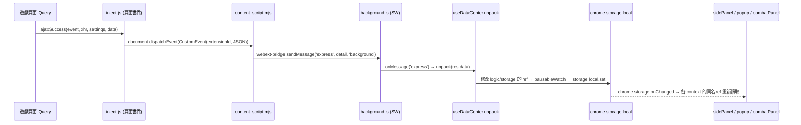
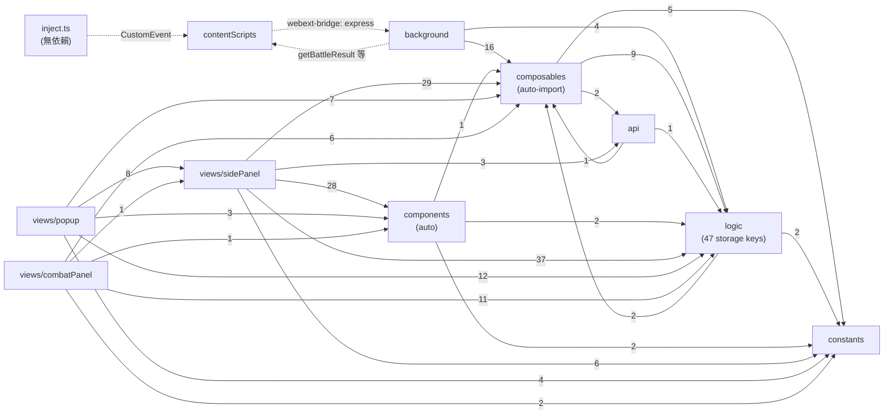

# Tarou 擴充功能架構研究（fork 開發規則前置調查）

- 調查日期：2026-10-10
- HEAD：`4cef1aaef3807e8e85ce38e3e15a80258661eaf7`（branch `claude/chrome-extension-architecture-75ed1c`，內容等同 fork 的 `main`：`4cef1aa Merge pull request #1 ...`）
- upstream/main：`50620ab0ebd3522f00f504ce454328a6b7048f43`（2026-09-18，`feat: 优化boss信息重复上传问题`）
- remote：`upstream` = `https://github.com/Waaatanuki/Chrome-Extension-Tarou.git`，`origin` = `https://github.com/Anuise/Chrome-Extension-Tarou-V2-Tactical-Navigator.git`
- 資料來源：只使用本 worktree 的原始碼、設定檔與 git 歷史。凡引用都以 `路徑:行號` 或 commit hash 標示。無法驗證之處會明確寫出。

## 0. 統計用指令（可重現）

所有指令都在 worktree 根目錄以 Git Bash 執行。

```bash
git fetch upstream
git rev-parse HEAD upstream/main
git merge-base HEAD upstream/main
git log upstream/main..HEAD --oneline
git log HEAD..upstream/main --oneline | wc -l
git diff upstream/main...HEAD --stat
git rev-list --count --no-merges upstream/main      # 888
git rev-list --count --merges upstream/main         # 1

# 全期間：各檔案被 upstream 修改的 commit 數
git log upstream/main --no-merges --name-only --pretty=format: | grep -v '^$' | sort | uniq -c | sort -rn | head -30
# 近 12 個月（2025-10-10 起，共 184 個非 merge commit）
git log upstream/main --no-merges --since=2025-10-10 --name-only --pretty=format: | grep -v '^$' | sort | uniq -c | sort -rn | head -30
# 最近 100 個非 merge commit（最早一筆為 2026-02-26）
git log upstream/main --no-merges -100 --name-only --pretty=format: | grep -v '^$' | sort | uniq -c | sort -rn | head -30
# 近 12 個月，以「檔案所在目錄」彙總
git log upstream/main --no-merges --since=2025-10-10 --name-only --pretty=format: | grep -v '^$' \
  | sed -E 's|/[^/]+$||; t; s|.*|(root)|' | sort | uniq -c | sort -rn | head -20
# 單檔 commit 數（全期間 / 近 12 個月）
git log upstream/main --no-merges --format=%h -- <path> | wc -l
git log upstream/main --no-merges --since=2025-10-10 --format=%h -- <path> | wc -l

# 新增某功能頁的 commit（用來追蹤「加功能的接觸面」）
git log upstream/main --diff-filter=A --format='%h %ad %s' --date=short -- src/views/sidePanel/views/<name>/index.vue
git show --stat 7036d6a 0a342e9
```

模組相依統計使用附錄 A 的 Node 腳本（`node deps.mjs <repoRoot>`）。

---

## 1. 整體分層與職責

### 1.1 目錄與職責

| 層 | 位置 | 職責（附證據） |
|---|---|---|
| **inject（頁面世界腳本）** | `src/contentScripts/inject.ts` | 由 content script 以 `<script src=inject.js?extensionId=...>` 注入到遊戲頁面本身的 JS 環境（`src/contentScripts/index.ts:110-118`）。輪詢等待頁面上的 jQuery（`inject.ts:13-14`），掛上 `$(document).ajaxSuccess`（`inject.ts:16`），把每次 AJAX 的 `url / requestData / responseData` 以 `CustomEvent(extensionId)` 丟回 DOM（`inject.ts:17-24`）。不經過 Vite 共用設定，故**不能**使用 `~/` 別名或 auto-import（見 1.2）。 |
| **contentScripts** | `src/contentScripts/index.ts` | (1) 注入 inject.js 並把 `CustomEvent` 以 webext-bridge 訊息 `express` 轉送到 background（`index.ts:119-121`）。(2) 提供 5 個「DOM 擷取」訊息處理器，供 background 在特定頁面載入後索取 HTML：`getBattleResult`（`:5`）、`getBattleHistoryResult`（`:26`）、`getSupportSummon`（`:47`）、`getNpczenith`（`:68`）、`getMypage`（`:89`），每個都以 200ms 輪詢等待 DOM 出現後回傳 `outerHTML`。 |
| **background（Service Worker）** | `src/background/*.ts` | 進入點 `src/background/index.ts`：接收 `express` 並呼叫 `unpack()`（`index.ts:10-17`），再註冊 6 組 Chrome 事件（`index.ts:19-24`）。`webRequest.ts` 監聽 `webRequest.onCompleted`，對結算頁/個人頁/角色頁/首頁向 content script 索取 DOM，並用 cheerio 解析（`webRequest.ts:11-195`）；`debugger.ts` 透過 `chrome.debugger` 讀 WebSocket frame 交給 `handleWsPayloadJson`（`debugger.ts:2-7`）；`tabs.ts` 控制 side panel 是否啟用（`tabs.ts:13-17`）；`runtime.ts` 安裝時註冊右鍵選單（`runtime.ts:6-9`）；`action.ts`、`contextMenus.ts` 處理工具列按鈕與右鍵選單（`contextMenus.ts:17-47`）。 |
| **composables** | `src/composables/*.ts`（13 檔） | 實質的「業務邏輯層」，且全部被 auto-import（`vite.config.mts:22`）。核心是 `useDataCenter.ts`（2001 行）的 `unpack()`：以一長串 `if (url.includes(...))` 依 URL 分派（`useDataCenter.ts:15-1046`）。其他：`useBattleLog.ts`（戰鬥日誌，910 行）、`useParty.ts`（隊伍）、`useDungeon.ts`（肉鴿）、`useUser.ts`（掉落/配置上傳）、`useWebExtensionStorage.ts`（storage ref 實作）、`useNotification.ts`、`useImage.ts`、`useUtils.ts`（含開視窗 `openPopupWindow`，`useUtils.ts:59-86`）、`format.ts` 等。注意：AGENTS.md 說「composables 使用默認導出」，但實際多數檔案是具名導出（例如 `useBattleLog.ts:5,78,299`、`useUtils.ts:4-88`），只有 `useUser.ts:6`、`useContextMenu.ts:1`、`useSnapdom.ts:18` 有 default export。 |
| **logic** | `src/logic/storage.ts`、`src/logic/index.ts` | 全域狀態的唯一宣告處：47 個 `useWebExtensionStorage(key, default)`（`storage.ts:12-80`），以註解分區（Debugger / Setting / Dashboard / BattleLog / Drop / Party / MarkedUser / Artifact / Odiant / Build / Gacha / Dungeon）。key 是**無前綴的扁平字串**（例如 `'battleRecord'`，`storage.ts:38`）。`logic/index.ts:1` 只做 `export * from './storage'`。 |
| **api** | `src/api/index.ts`、`src/api/request.ts` | 對作者後端的 HTTP 呼叫（`/ext/multiDrop`、`/ext/startJson`、`/ext/build/*`、`/ext/config/*` 等，`api/index.ts:6-93`）。`request.ts:4` 以 `import.meta.env.VITE_APP_BASE_API` 作為 baseURL，並在 header 帶上 `code`（引繼碼）與 `uid`（`request.ts:9-16`）。`VITE_APP_BASE_API` 定義在已進版控的 `.env.development`、`.env.production`（`git ls-files` 可見）。 |
| **views** | `src/views/{sidePanel,popup,combatPanel}` | 三個 Vue app，各自有 `main.html / main.ts / main.vue`。`sidePanel` 為主介面，以 `import.meta.glob('./views/*/index.vue')` 依目錄名自動建立頁面表（`sidePanel/main.vue:6-16`），但**側欄按鈕清單是手寫的**（`main.vue:23-41`）。`popup` 是以 URL query 決定要顯示 `./components/<Key>.vue`（`popup/main.vue:2-13`），由 `openPopupWindow(key)` 開窗（`useUtils.ts:59-86`）。`combatPanel` 會把 `./components/*.vue` 全部渲染，並用 `combatPanelSetting[元件名]` 決定顯示與位置（`combatPanel/main.vue:7,30-33`）。 |
| **components** | `src/components/*.vue`（11 檔） | 跨頁共用元件，由 unplugin-vue-components 自動註冊（`vite.config.mts:27-30`，預設掃描 `src/components`）。 |
| **constants** | `src/constants/*.ts` | 預設值與靜態表：`defaultNotificationSetting`、`defaultWidget`、`defaultCombatPanelSetting`（`constants/index.ts:6,35,45`）、神器、活動、技能、肉鴿常數。 |
| **types** | `types/global.d.ts`、`types/modules/*.d.ts` | `global.d.ts:16-26` 以 module augmentation 宣告 webext-bridge 的 `ProtocolMap`；`types/modules/` 以 ambient module 宣告 `'api' / 'battle' / 'extension' / 'party' / 'source'` 五個型別模組（`types/modules/index.d.ts:6-10`），程式中以 `import type { ... } from 'extension'` 方式使用（例：`storage.ts:3`）。`extension.d.ts` 515 行、`source.d.ts` 731 行。 |
| **開發用 playground** | `index.html`、`src/main.ts`、`src/App.vue` | `pnpm dev` 啟動 Vite dev server 時的頁面（`index.html:12` 載入 `/src/main.ts`）。`App.vue` 是測試用 Demo（`App.vue:1-11`），**不在**擴充功能建置的 entry 中（見 1.2 `getEntry` 只掃 `src/views/**/main.ts`）。 |
| **scripts** | `scripts/*.ts` | `prepare.ts` 複製 `manifest.json` 與 icon 到 `dist`（`scripts/prepare.ts:4,24`）；`zip.ts` 打包成 `Chrome-Extension-Tarou v<version>.zip`；`log.ts`、`release.ts` 用於 GitHub Actions 發版（`.github/workflows/release.yml:23-40`）。 |

### 1.2 Vite 設定檔與輸出

| 設定檔 | Entry | 輸出 | 共用 `sharedConfig`？ |
|---|---|---|---|
| `vite.config.mts` | `getEntry()`：以 `fast-glob` 掃 `src/views/**/main.ts`，每個轉成 `assets/<目錄名>` → 對應的 `main.html`；另加 `background: src/background/index.ts`（`vite.config.mts:41-50`）。 | `dist/`，`entryFileNames: '[name].js'`（`:54-63`），因此 background 輸出為 `dist/background.js`，對應 `manifest.json` 的 `"service_worker": "background.js"`。 | 定義者（`:12-39`）：`~/` 別名（`:13-17`）、Vue、AutoImport（`vue`、`@vueuse/core`、`src/composables`、ElementPlus resolver，dts 寫到 `types/auto-imports.d.ts`，`:20-26`）、Components（ElementPlus + VueUse resolver，`:27-30`）、UnoCSS。 |
| `vite.config.content.mts` | `src/contentScripts/index.ts`（lib, iife，`vite.config.content.mts:13-16`） | `dist/content_script.mjs`（`:20`），對應 manifest 的 `content_scripts.js`。 | 是（`:4,7`），所以 content script 也能用 `~/` 與 auto-import。 |
| `vite.config.inject.mts` | `src/contentScripts/inject.ts`（lib, iife，`vite.config.inject.mts:12-15`） | `dist/inject.js`（`:18`），對應 manifest 的 `web_accessible_resources`。 | **否**：整個檔案沒有 plugins/alias（`:1-23`），inject.ts 必須是自足的純 TS。 |

HTML 頁面的實際輸出路徑：程式中以 `src/views/sidePanel/main.html`（`background/tabs.ts:15`）、`src/views/popup/main.html?<key>`（`useUtils.ts:83`）、`src/views/combatPanel/main.html`（`useUtils.ts:90`）開啟，表示 Vite 保留了 HTML 的原始相對路徑。此點是由程式碼推得，本次未實際執行 build 驗證 `dist/` 結構。

### 1.3 Manifest 與建置腳本

- **Manifest 是手寫的靜態 JSON**（`manifest.json`），沒有 `src/manifest.ts` 之類的生成器；建置時由 `scripts/prepare.ts:24` 原樣複製到 `dist/manifest.json`。版本號在 `manifest.json:4`（目前 `3.7.1`）。權限含 `debugger`、`webRequest`、`sidePanel` 等（`manifest.json:10`），host 權限涵蓋 `*.granbluefantasy.jp`、`gbf.game.mbga.jp`、`*.akamaized.net`、`localhost`（`manifest.json:11-16`）。
- `package.json` scripts：
  - `ba` / `bp` = `clear` → `build:alp|build:prod`（主設定）→ `build:prepare`（複製 manifest/icon）→ `build:js`（依序建 content 與 inject，`package.json` 的 `build:js` 行）。
  - `dev` = `vite --port 1234 --open`（只跑 playground，非擴充功能本體）。
  - `zip`、`log`、`lint`（`eslint --cache .`）、`tc`（`vue-tsc --noEmit`）。
- auto-import 產生的 `types/auto-imports.d.ts`、`types/components.d.ts` 被 `.gitignore:8-9` 排除，本 worktree 未安裝 `node_modules` 也未建置，因此**無法直接讀取生成的 d.ts**；第 3 節的 auto-import 相依是用原始碼掃描推得（方法見附錄 A）。

---

## 2. 端到端資料流

### 2.1 主幹（AJAX 被動擷取）



| 步驟 | 檔案:行 | 函式 / 說明 |
|---|---|---|
| 1. 注入 | `src/contentScripts/index.ts:110-118` | `injectScript()` 建立 `<script>`，src 為 `chrome.runtime.getURL('inject.js?extensionId=...')`。 |
| 2. 攔截 AJAX | `src/contentScripts/inject.ts:13-24` | 等到 `$`/`jQuery` 存在（最多 100 次 × 100ms，`:2-3,27-29`），`$(document).ajaxSuccess` 把 `{url, requestData: settings.data, responseData: data}` 序列化後 dispatch。 |
| 3. 轉送 | `src/contentScripts/index.ts:119-121` | 監聽同名 `CustomEvent`，`sendMessage('express', detail, 'background')`。 |
| 4. 接收 | `src/background/index.ts:10-17` | `onMessage('express', res => unpack(res.data))`，錯誤只 `console.log`。`unpack` 是 auto-import 進來的（未見顯式 import，`index.ts:1-7`）。 |
| 5. 分派 | `src/composables/useDataCenter.ts:15-1046` | `unpack(parcel)`：`JSON.parse`（`:19`）→ 先跑 `processEventData`（`:24`）→ 之後是約 80 個依 URL 判斷的區塊。 |
| 6. 寫入狀態 | `src/logic/storage.ts:12-80` + `src/composables/useWebExtensionStorage.ts` | 各區塊直接修改 `xxx.value`；`useWebExtensionStorage` 以 `pausableWatch(data, write, {deep:true})`（`:118-125`）把變更寫入 `chrome.storage.local.set`（`:34-36`）。 |
| 7. UI 更新 | `src/composables/useWebExtensionStorage.ts:127-147` | 每個 context（background、各 view）都各自 import `~/logic`，各自建立 ref；靠 `chrome.storage.onChanged` 同步。**UI 與 background 之間沒有直接訊息往來**，狀態同步完全經由 storage。 |

重要細節：`unpack` 的各區塊不是互斥的 `else if`，而是循序 `if`，且部分區塊內有 `return` 會**直接結束整個 `unpack`**，例如 `:134-135`（首頁無 `mbp_limit_info`）、`:222-223`、`:703-704`（沙盒系列副本不上傳 boss 資訊）、`:1033-1034`。因此「在 `unpack` 尾端追加新處理」並不保證一定會被執行。

### 2.2 第二條路：webRequest + DOM 擷取（掉落）

AJAX 回應拿不到的資料（結算畫面的掉落物 DOM），走的是 background 主動索取：

| 步驟 | 檔案:行 | 說明 |
|---|---|---|
| 1 | `src/background/webRequest.ts:11-13` | `chrome.webRequest.onCompleted` 偵測 URL 符合 `/result(multi)?/content/index`。 |
| 2 | `webRequest.ts:14-18` | `checkUser()` 從 URL 取 uid；以 battleId 在 `battleMemo` 找紀錄（`battleMemo` 是在進入副本時由 `useDataCenter.ts:75,107,671` 寫入）。找不到就放棄。 |
| 3 | `webRequest.ts:20` | `sendMessage('getBattleResult', null, { context: 'content-script', tabId })`。 |
| 4 | `src/contentScripts/index.ts:5-23` | content script 每 200ms 查 `.prt-item-list`，找到即回傳 `{ domStr }`；URL 離開結算頁則回傳 `{}`。 |
| 5 | `webRequest.ts:23, 198-241` | `getTreasureList()` 用 cheerio 解析掉落；若命中 `notificationItem` 就發通知（`:212-213, 247-261`）。 |
| 6 | `webRequest.ts:33` → `src/composables/useUser.ts:17-45` | `sendDrop()`：先合併進 `failedDropInfoList`（`useUser.ts:47-57`），以每批 1000 筆呼叫 `sendMultiDropInfo`（`useUser.ts:32` → `api/index.ts:22-27` → `POST /ext/multiDrop`），成功後移除（`useUser.ts:59-64`），失敗時以 badge 顯示待傳數量（`useUser.ts:66-71`）。 |
| 7 | `webRequest.ts:34, 243-245` | 成功後 `cleanBattleMemo()`（同時清除 14 天以上的 memo）。 |
| 8 | `webRequest.ts:37` → `useUser.ts:73-98` | `sendBuild()` 上傳本場隊伍配置（可由 `notificationSetting.cancelAutoUploadBuild` 關閉）。 |
| 9 UI | `src/views/sidePanel/views/drop/index.vue:4,36` | 掉落統計頁**不讀本機掉落資料**，而是 `listDrop(questIds)` 向後端查統計；本機只保存 `questConfig`（要顯示哪些副本，`storage.ts:46`）。 |

### 2.3 具體範例：戰鬥（battle start → 攻擊 → 結算 → UI）

1. 進入副本：`/quest/create_quest`（自發）或 `/quest/raid_deck_data_create`（參戰）時，`unpack` 在 `battleMemo` 寫一筆（`useDataCenter.ts:53-76, 92-108`）。
2. `/rest/(raid|multiraid)/start.json`：`useDataCenter.ts:659-726`。補上 questName（`:662-676`）、更新每日統計（`:682-697`）、呼叫 `handleStartJson()`（`:700`，定義於 `useBattleLog.ts:5`；其中 `recordRaidInfo` 於 `useBattleLog.ts:72,406` 以 `battleRecord.value.unshift(...)` 建立紀錄，`:482`），再組出 boss 資訊交給 `processBossInfo()`（`:725`，定義 `:1976-2001`，以 `sentBossInfo` LRU 去重並 10% 抽樣後 `sendBossInfo` → `POST /ext/startJson`，`api/index.ts:30-35`）。
3. 攻擊/技能/召喚等：`useDataCenter.ts:614-651` 依 regex 呼叫 `handleAttackResultJson(type, ...)`（`useBattleLog.ts:78`），以 `battleInfo.bossInfo.battleId` 找到 `battleRecord` 當筆並更新（`useBattleLog.ts:92`）。
4. WebSocket（多人戰 boss 血量）：`/socket/uri/raid` 時若 sidePanel 或 combatPanel 開著就 `chrome.debugger.attach` 並 `Network.enable`（`useDataCenter.ts:831-851`）；之後 `background/debugger.ts:2-7` 接收 frame → `handleWsPayloadJson`（`useBattleLog.ts:299-304`）更新 `battleInfo.bossInfo.hp`。
5. 結算：`/result(multi)?/content/(index|skip_raid)/\d+` → `handleResultContent()`（`useDataCenter.ts:654-656, 1048-`），並行地 2.2 節的掉落流程也被觸發。
6. UI：`src/views/sidePanel/views/combat/index.vue:2,10` 直接 import `battleInfo`、`battleRecord`，以 `computed` 找到當前紀錄渲染；combatPanel 的元件同樣讀 `~/logic`（第 3 節：`views/combatPanel → logic` 11 條邊）。

### 2.4 訊息協定一覽（webext-bridge）

| 訊息 | 方向 | 傳送處 | 接收處 | 型別宣告 |
|---|---|---|---|---|
| `express` | content → background | `contentScripts/index.ts:120` | `background/index.ts:10` | **未宣告**在 `ProtocolMap` |
| `getBattleResult` | background → content | `webRequest.ts:20` | `contentScripts/index.ts:5` | `types/global.d.ts:19` |
| `getBattleHistoryResult` | background → content | `webRequest.ts:48` | `contentScripts/index.ts:26` | `global.d.ts:20` |
| `getSupportSummon` | background → content | `webRequest.ts:85` | `contentScripts/index.ts:47` | `global.d.ts:22` |
| `getNpczenith` | background → content | `webRequest.ts:118` | `contentScripts/index.ts:68` | `global.d.ts:23` |
| `getMypage` | background → content | `webRequest.ts:154` | `contentScripts/index.ts:89` | `global.d.ts:24` |
| `getRaidName`、`getUnclaimedList` | — | 無 | 無 | `global.d.ts:18,21`（`grep` 於 `src/` 無任何使用，屬殘留宣告） |

所有訊息名稱同樣是無前綴的扁平命名空間。

---

## 3. 模組相依圖

### 3.1 計算方法

附錄 A 腳本掃描 `src/**/*.{ts,vue}`（119 檔），產生 278 條邊：

- **explicit**：`import ... from '~/...'` 或相對路徑（含 `import type`），解析到實際檔案。
- **auto**：`src/composables` 的所有具名導出與 default export（以檔名為識別字），若某檔以 `識別字(` 或 `識別字<` 形式使用、且未自行 import 或宣告，就記一條邊。這模擬 `vite.config.mts:20-26` 的 AutoImport 行為，屬**啟發式**，可能有少量誤判（例如區域變數同名）。
- **auto-component**：`src/components/*.vue` 依 PascalCase 或 kebab-case 標籤出現在 `.vue` 中。
- `import.meta.glob` 另列（三個 view 的 main.vue）。
- 不計 `vue`、`@vueuse/core`、Element Plus 的 auto-import（外部套件）。

### 3.2 Fan-in 最高的模組（相異匯入者數）

| 模組 | explicit | auto | 合計 | 備註 |
|---|---:|---:|---:|---|
| `src/logic/index.ts` | 73 | 0 | **73** | 全專案狀態入口；另有 3 檔直接 import `~/logic/storage`（`webRequest.ts:6`、`drop/index.vue:5` 等），合計 76 |
| `src/composables/format.ts` | 0 | 20 | 20 | 格式化工具 |
| `src/composables/useUtils.ts` | 0 | 16 | 16 | `deepClone`、`openPopupWindow`、`isGamePage` 等 |
| `src/components/TheButton.vue` | 0 | 14 | 14 | |
| `src/composables/useNotification.ts` | 0 | 14 | 14 | `createNotification` |
| `src/composables/useImage.ts` | 0 | 9 | 9 | |
| `src/constants/index.ts` | 9 | 0 | 9 | |
| `src/components/MissionList.vue` | 0 | 9 | 9 | |
| `src/constants/artifact.ts` | 6 | 0 | 6 | |
| `src/api/index.ts` | 5 | 0 | 5 | `useDataCenter`、`useUser`、build/drop/info 三個頁面 |
| `src/composables/useSnapdom.ts` | 0 | 5 | 5 | |

`useDataCenter.ts` 本身 fan-in 只有 1（`background/index.ts` 的 `unpack`），但 fan-out 很大：顯式依賴 `~/api`、`~/constants/artifact`、`~/constants/event`、`~/logic`（`useDataCenter.ts:7-10`），auto 依賴 `format`、`useBattleLog`、`useDungeon`、`useImage`、`useNotification`、`useParty`。也就是說它是「資料寫入端的總閘」，而 `logic` 是「狀態的總匯流排」。

### 3.3 層級相依圖（跨層邊數）



觀察：

1. **循環相依**：`logic → composables`（`storage.ts:7` 顯式 import `useWebExtensionStorage`，`storage.ts:19` 以 auto-import 使用 `deepClone`）與 `composables → logic`（9 條）形成環；`api/request.ts → useUser`（`request.ts:5` 的 `useUser()`）與 `useUser → api`（`useUser.ts:3`）也是環。打包可運作，但代表層次並非嚴格單向。
2. **view 之間互相引用**：popup 的 `BuildCompare.vue`、`ExportRecord.vue` 直接 import sidePanel 的 `party/components/{Npc,Summon,Weapon}.vue` 與 `combat/components/{ActionList,DamageRecord}.vue`；combatPanel 的 `ActionList.vue` import sidePanel 的 `NormalAttackInfo.vue`。所以 `src/views/sidePanel/views/*/components` 實際上也是共用元件。
3. **background 會把 composables 打包進 Service Worker**：16 條 auto 邊（`useContextMenu`、`useNotification`、`useUtils`、`format`、`useImage`、`useUser`、`useBattleLog`、`useDataCenter`），而 `logic` 被 import 時會一次建立全部 47 個 storage ref（`storage.ts:12-80`）。
4. inject.ts 沒有任何 import（`inject.ts:1-31`），與其他層完全隔離。

---

## 4. 擴充點：加功能的最小接觸面

### 4.1 以既有 commit 為例

**範例 A：`7036d6a`（2026-06-15）`feat: 增加禁祸武器筛选功能`** — 5 檔、+130/-2，是「新增一個側欄頁＋擷取一種 AJAX」的最小樣板：

| 檔案 | 變更 | 現行位置 |
|---|---|---|
| `src/views/sidePanel/views/odiant/index.vue` | 新增頁面（99 行） | 由 `import.meta.glob('./views/*/index.vue')` 自動收錄（`sidePanel/main.vue:7`） |
| `src/views/sidePanel/main.vue` | 側欄按鈕清單加 1 行 | `main.vue:27` `{ key: 'odiant', ... }` |
| `src/logic/storage.ts` | 新增 storage key ＋改 `import type` 行 | `storage.ts:65-66` `weaponList`；`storage.ts:3` 的長 import 行 |
| `src/composables/useDataCenter.ts` | 在 `unpack` 中插入 URL 分支＋改 `~/logic` 的長 import 行 | `useDataCenter.ts:780-794`；`:10` |
| `types/modules/extension.d.ts` | 新增 `OdiantWeapon` 介面 | `extension.d.ts:461-468` |

**範例 B：`0a342e9`（2026-07-24）`feat: 新增肉鸽情报功能`** — 12 檔、+901/-7：除了範例 A 的 5 類接觸點外，還動到 `useBattleLog.ts`（戰鬥中多 boss 血量）、新增 `useDungeon.ts`、`constants/dungeon.ts`、popup 元件 `DungeonMap.vue`、`useUtils.ts`（`openPopupWindow` 的視窗尺寸表，現 `useUtils.ts:66`）、`types/modules/source.d.ts`、`src/App.vue`。

**範例 C：`1d64a1f`（2025-04-11）`feat: 新增注入脚本用于获取接口信息`** — 建立目前的 inject → content → background 管線時，改了 `manifest.json`、`package.json`、`background/index.ts`、`contentScripts/index.ts`、新增 `inject.ts` 與 `vite.config.inject.mts`。這類「新的訊息管線 / 新 entry」需要動到建置層。

### 4.2 各類需求的接觸點清單

| 想做的事 | 必改檔案（現行登錄位置） | 備註 |
|---|---|---|
| 新增側欄頁 | 新建 `src/views/sidePanel/views/<key>/index.vue`；`src/views/sidePanel/main.vue:23-36`（或 `:38-41`）加一筆 `{ key, label, icon }` | 目錄名即 key（`main.vue:11`）。沒有 router，也沒有選單設定檔。 |
| 新增 popup 視窗 | 新建 `src/views/popup/components/<Key>.vue`；呼叫端 `openPopupWindow('<Key>')`；若需非預設尺寸則改 `useUtils.ts:60-70` | 預設 800×800（`useUtils.ts:76`）。 |
| 新增 combatPanel 元件 | 新建 `src/views/combatPanel/components/<Name>.vue`；**必須**在 `defaultCombatPanelSetting`（`constants/index.ts:45-103`）與 `CombatPanelSetting` 型別（`types/modules/extension.d.ts:429`）加同名 key | `combatPanel/main.vue:30` 以 `combatPanelSetting[componentName].visible` 取值，缺 key 會在執行期出錯（`.visible` of undefined）。 |
| 新增持久化狀態 | `src/logic/storage.ts` 加 `useWebExtensionStorage` 並改第 1-5 行的 `import type` | key 無命名空間；與 upstream 同名即共用同一份 storage。 |
| 擷取新的遊戲 AJAX | `src/composables/useDataCenter.ts` 的 `unpack()` 插入 `if (url.includes(...))`，並改 `:10` 的 `~/logic` import | 注意 2.1 所述的提前 `return`。 |
| 擷取 AJAX 拿不到的 DOM | `background/webRequest.ts` 加 URL 判斷＋`sendMessage`；`contentScripts/index.ts` 加 `onMessage`；`types/global.d.ts:17-25` 加 `ProtocolMap` | 3 檔皆為共用檔。 |
| 新的資料型別 | `types/modules/*.d.ts`（多為 `extension.d.ts`） | |
| 新的後端 API | `src/api/index.ts` | baseURL 綁 `VITE_APP_BASE_API`（`request.ts:4`）。 |
| 右鍵選單 | `useContextMenu.ts:2-6` 註冊＋`background/contextMenus.ts:17-47` switch | |
| 新的 background 監聽 | `background/index.ts:19-24` 加一行 `setupXxxListener()` 並新增檔案 | |
| 新的獨立頁面（HTML entry） | 新建 `src/views/<name>/{main.html,main.ts,main.vue}` 即會被 `getEntry()` 自動收錄（`vite.config.mts:43-47`） | **不需改 vite 設定**；manifest 也不需改，除非要作為 action/side panel 預設頁。 |
| 新的 content/inject entry | 新 vite config＋`package.json` 的 `build:js`＋`manifest.json` | 成本最高、與 upstream 衝突面也最大。 |
| 版本號 | `manifest.json:4` | |
| i18n | 無 i18n 機制：UI 文字直接寫死簡體中文（例 `sidePanel/main.vue:24-40`），Element Plus 固定 `zhCn`（`main.vue:3,76`）。唯一的語言設定是神器頁的 `language: 'zh' | 'ja'`（`storage.ts:60`）。 | |

---

## 5. 高衝突風險檔案（upstream 修改頻率）

upstream 共有 888 個非 merge commit（2023-03-13 至 2026-09-18）。近 12 個月（2025-10-10 起）184 個，月分布：2025-10 35、11 29、12 6、2026-01 6、02 9、03 13、04 21、05 13、06 38、07 9、08 2、09 3。

### 5.1 近 12 個月（184 commits）最常被改的檔案

| # | 檔案 | commits | 屬第 4 節接觸點？ |
|---:|---|---:|---|
| 1 | `types/modules/extension.d.ts` | 33 | 是（型別） |
| 2 | `src/composables/useBattleLog.ts` | 33 | 戰鬥相關 |
| 3 | `src/composables/useDataCenter.ts` | 30 | **是（AJAX 分派）** |
| 4 | `src/constants/index.ts` | 20 | 是（combatPanel 預設值） |
| 5 | `types/modules/source.d.ts` | 19 | 是 |
| 6 | `manifest.json` | 19 | 是（**19 筆全是 `chore: 更新版号x.y.z`**） |
| 7 | `changelog.json` | 19 | — |
| 8 | `src/logic/storage.ts` | 18 | **是（storage key）** |
| 9 | `src/views/sidePanel/views/build/index.vue` | 16 | |
| 10 | `src/views/sidePanel/views/party/components/Npc.vue` | 14 | （被 popup 共用） |
| 11 | `src/views/popup/components/ExportRecord.vue` | 14 | |
| 12 | `src/composables/useParty.ts` | 14 | |
| 13 | `src/composables/useUtils.ts` | 11 | 是（popup 尺寸表） |
| 14 | `src/components/ArtifactCard.vue` | 11 | |
| 15 | `src/background/webRequest.ts` | 11 | 是（DOM 擷取） |
| 16 | `types/modules/party.d.ts` | 10 | |
| 17 | `types/modules/battle.d.ts` | 10 | |
| 18 | `src/views/sidePanel/views/setting/index.vue` | 10 | |
| 19 | `src/views/sidePanel/views/combat/components/ActionList.vue` | 10 | |
| 20 | `src/views/combatPanel/components/CommandBar.vue` | 10 | |
| 21 | `src/composables/format.ts` | 10 | |

近 12 個月中，有 57 / 184 個 commit 至少動到 `useDataCenter.ts`、`storage.ts`、`extension.d.ts` 其中之一。

### 5.2 最近 100 個 commit（2026-02-26 起）

| 檔案 | commits |
|---|---:|
| `src/composables/useDataCenter.ts` | 19 |
| `src/composables/useBattleLog.ts` | 19 |
| `types/modules/extension.d.ts` | 16 |
| `src/views/sidePanel/views/build/index.vue` | 14 |
| `manifest.json` | 12 |
| `changelog.json` | 12 |
| `src/logic/storage.ts` | 11 |
| `src/views/popup/components/ExportRecord.vue` | 10 |
| `src/composables/format.ts` | 10 |
| `src/views/sidePanel/views/setting/index.vue` | 9 |
| `src/composables/useParty.ts` | 9 |
| `src/background/webRequest.ts` | 9 |

### 5.3 全期間（仍存在的檔案）

| 檔案 | commits | 備註 |
|---|---:|---|
| `manifest.json` | 133 | |
| `types/global.d.ts` | 121 | 多數發生在拆分型別前；`81957f4 feat: 拆分并优化类型文件` 之後近 12 個月僅 2 次 |
| `src/composables/useDataCenter.ts` | 119 | |
| `src/composables/useBattleLog.ts` | 76 | |
| `package.json` | 74 | |
| `src/views/popup/main.vue` | 73 | 近 12 個月僅 3 次 |
| `src/logic/storage.ts` | 72 | |
| `src/App.vue` | 65 | dev playground |
| `pnpm-lock.yaml` | 64 | |
| `src/background/index.ts` | 46 | 近 12 個月 0 次 |
| `src/constants/index.ts` | 36 | |
| `src/views/sidePanel/main.vue` | 35 | 近 12 個月 7 次（多為新增頁面時加一行） |
| `changelog.json` | 35 | |
| `types/modules/extension.d.ts` | 33 | 2025 年底拆出後全部集中在近 12 個月 |

全期間前 30 名中有已被刪除的路徑（`src/views/panel/*`、`src/views/debugger/*`、`src/script/background.ts`、`types/global.ts`），例如 `5e445a6 feat: 移除详细面板相关功能`，顯示 upstream 曾多次整批搬移/刪除目錄，也有 `7387da2 feat: 组件改为自动导入`、`81957f4 feat: 拆分并优化类型文件` 這類全域重構。

### 5.4 目錄層級（近 12 個月，檔案異動次數）

| 目錄 | 異動次數 |
|---|---:|
| `src/composables` | 118 |
| `types/modules` | 80 |
| (根目錄檔案：manifest/changelog/package 等) | 63 |
| `src/views/combatPanel/components` | 53 |
| `src/views/popup/components` | 42 |
| `src/views/sidePanel/views/combat/components` | 38 |
| `src/constants` | 28 |
| `src/components` | 27 |
| `src/views/sidePanel/views/dashboard/event` | 22 |
| `src/views/sidePanel/views/party/components` | 20 |
| `src/logic` | 18 |
| `src/views/sidePanel/views/dashboard/components` | 17 |
| `src/background` | 13 |

### 5.5 與第 4 節接觸點交叉比對

| 接觸點 | 全期間 | 近 12 月 | 最近 100 | 衝突風險 |
|---|---:|---:|---:|---|
| `src/composables/useDataCenter.ts`（`unpack` 與 `:10` 長 import 行） | 119 | 30 | 19 | **極高**：單一函式、單一 import 行，每個新功能都會改這兩處 |
| `src/logic/storage.ts`（`:3` 長 import type 行＋key 清單） | 72 | 18 | 11 | **高**：同一行 import 幾乎每次新增 key 都會被改 |
| `types/modules/extension.d.ts` | 33 | 33 | 16 | **高**（多為檔尾追加，但檔尾正是 fork 也會追加的位置） |
| `manifest.json` | 133 | 19 | 12 | **版本行必衝突**：19/19 為版號 bump，fork 若改 `manifest.json:4` 每次發版都會衝突 |
| `src/constants/index.ts` | 36 | 20 | 4 | 中高（combatPanel 預設值） |
| `src/composables/useUtils.ts`（popup 尺寸表） | 24 | 11 | 5 | 中 |
| `src/background/webRequest.ts` | 13 | 11 | 9 | 中（近期活躍） |
| `src/views/sidePanel/main.vue`（選單陣列） | 35 | 7 | 2 | 中（每次新增頁面加一行，相鄰行衝突機率高） |
| `src/api/index.ts` | 24 | 5 | 4 | 低中 |
| `types/global.d.ts`（`ProtocolMap`） | 121 | 2 | 0 | 低（近期） |
| `src/background/index.ts` | 46 | 0 | 0 | 低（近期穩定） |
| `src/contentScripts/index.ts` | 10 | 0 | 0 | 低 |
| `src/contentScripts/inject.ts` | 1 | 0 | 0 | 極低 |
| `vite.config.mts` | 7 | 1 | 0 | 低 |
| `src/views/popup/main.vue` / `combatPanel/main.vue` | 73 / 4 | 3 / 4 | 0 / 0 | 低 |

---

## 6. Fork 與 upstream 的差異

| 項目 | 結果 |
|---|---|
| `git merge-base HEAD upstream/main` | `50620ab0ebd3522f00f504ce454328a6b7048f43`，**等於 upstream/main 本身** |
| `git log upstream/main..HEAD`（fork 領先） | 2 個：`bb54e63 docs: add agent skills config (...)`、`4cef1aa Merge pull request #1 ...` |
| `git log HEAD..upstream/main --oneline \| wc -l`（fork 落後） | **0** |
| `git diff upstream/main...HEAD --stat` | 4 檔、+110 行，全為文件：`AGENTS.md`(+14)、`docs/agents/domain.md`(+51)、`docs/agents/issue-tracker.md`(+30)、`docs/agents/triage-labels.md`(+15) |

結論：截至 2026-10-10，fork 與 upstream 完全同步，尚未有任何程式碼分歧。這是制定規則的最佳時間點。唯一的共同修改檔是 `AGENTS.md`（upstream 也有此檔，fork 在其尾端追加 14 行），之後 upstream 若修改 `AGENTS.md` 尾端可能產生小衝突。

---

## 7. 結論（供撰寫 fork 開發規則參考）

### 7.1 宜視為「唯讀、不修改」的區域

| 區域 | 理由 |
|---|---|
| `src/composables/useDataCenter.ts` | upstream 最熱點（119 / 30 / 19），且 `unpack` 是單一長函式、`:10` 是單一長 import 行，任何插入都幾乎必衝突；另有提前 `return`（`:135, :704` 等）使追加邏輯不可靠。 |
| `src/composables/useBattleLog.ts`、`useParty.ts`、`format.ts` | 近 12 個月 33 / 14 / 10 次，戰鬥與隊伍是 upstream 主要開發方向。 |
| `src/logic/storage.ts` | 72 / 18 / 11，且 `:3` 的 type import 行每次新增 key 都會被改。 |
| `types/modules/*.d.ts`（特別是 `extension.d.ts`） | 33 / 33 / 16，新介面多追加在檔尾，與 fork 追加位置重疊。 |
| `manifest.json:4` 版本行、`changelog.json` | 19/19 為版本 bump。fork 若要自己的版號或名稱，建議在建置流程中覆寫 `dist/manifest.json`，而非修改原始檔。 |
| `src/views/sidePanel/views/*` 既有頁面、`src/views/combatPanel/components/*`、`src/views/popup/components/*` | 近 12 個月合計上百次異動；且有跨 view 互相 import（3.3 觀察 2），改一處可能影響多處。 |

### 7.2 適合用 adapter / wrapper 的區域

| 需求 | 建議做法 | 依據 |
|---|---|---|
| 讀取遊戲 AJAX | **不要改 `unpack`**。在 `background/index.ts` 另外註冊一個 `onMessage('express', ...)` 監聽者，或在自有模組中寫自己的分派器並在 `index.ts` 呼叫一次。需先驗證 webext-bridge 是否允許同一訊息名稱有多個 `onMessage` 處理器——**本次未驗證**；若不允許，最小侵入做法是在 `background/index.ts:12` 後加一行呼叫自有的 `myUnpack(res.data)`。 | `background/index.ts` 近 12 個月 0 次、最近 100 次 0 次修改；`express` 的 payload 是完整的 `{url, requestData, responseData}`（`inject.ts:18-22`），自有分派器可完全獨立於 `unpack`。 |
| 讀取 upstream 狀態 | 自有程式只 **import 唯讀使用** `~/logic` 中的 ref（如 `battleRecord`、`battleInfo`），不寫入；或以 `computed` 包一層。 | `logic` 是全專案 fan-in 最高的匯流排（73），所有 context 都可直接讀；同步機制由 `useWebExtensionStorage.ts:127-147` 保證。 |
| 寫入自有狀態 | 在自有檔案中直接呼叫 `useWebExtensionStorage('<prefix>:<key>', default)`，不放進 `storage.ts`。 | `useWebExtensionStorage` 是一般函式，任何檔案都可呼叫（`useWebExtensionStorage.ts:52`）；`storage.ts` 只是集中宣告處。 |
| 需要 DOM 擷取 | 在 `background/` 新增自有 `setupXxxListener()` 檔案（`webRequest.onCompleted` 可多處註冊），在 `contentScripts/index.ts` 只加最少的 `onMessage`；`ProtocolMap` 可用另一個 `.d.ts` 再次 augmentation，不必改 `global.d.ts`。 | `webRequest.ts` 近期活躍（11 / 9）；`global.d.ts` 是以 `declare module 'webext-bridge'` 擴充介面（`global.d.ts:16-17`），TypeScript interface 可在其他檔案合併宣告。 |
| 後端 API | 自有工具若需要後端，應另寫 request 模組與自有 env 變數，不要沿用 `src/api/request.ts`。 | `request.ts:4` 綁定 upstream 作者的 `VITE_APP_BASE_API`（已進版控的 `.env.*`），且會帶 `code`/`uid` header（`request.ts:13-14`）；沿用會把 fork 資料送到 upstream 的伺服器。 |
| 版本更新提示 | 若 fork 版本號與 upstream 不同，需留意 `useVersionCheck.ts:34` 寫死抓 `Waaatanuki/Chrome-Extension-Tarou/main/changelog.json`。 | 不改會一直以 upstream 的版號判斷是否有更新。 |

### 7.3 新工具最適合放的位置

1. **獨立目錄**：
   - 業務邏輯：例如 `src/<fork 名>/`（或 `src/composables/<prefix>*` 之外的獨立資料夾）。注意 `src/composables/` 內任何檔案都會被 auto-import 成全域識別字（`vite.config.mts:22`），新檔若與 upstream 日後新增的函式同名會衝突；放在 composables 以外並以顯式 import 使用，可避免全域命名碰撞。
   - UI：若要出現在側欄，新增 `src/views/sidePanel/views/<prefix>-<name>/index.vue`（自動收錄，`sidePanel/main.vue:7`），只需在選單陣列加一行（`main.vue:23-41`）。為降低與 upstream 新增頁面的相鄰行衝突，可考慮把自有選單項放在一個自有模組匯出的陣列，於 `main.vue` 以一行展開；或放在 `downViewList` 這種較少被改動的陣列。
   - 若工具不需要嵌入側欄，**獨立 HTML entry**（`src/views/<prefix>Tool/main.{html,ts,vue}`）完全不需修改任何既有檔案即可被建置（`vite.config.mts:43-47`），只需從某處以 `chrome.windows.create` 或 `chrome.runtime.getURL` 開啟。
2. **獨立 storage key 命名空間**：upstream 的 47 個 key 全無前綴（`storage.ts:12-80`），也有 Debug 頁會列出所有 key（`popup/components/Debug.vue:48`）。建議 fork 一律使用固定前綴（例如 `fork:`），避免日後 upstream 新增同名 key 時共用同一份資料。
3. **獨立訊息命名空間**：upstream 的 webext-bridge 訊息名同樣無前綴（2.4 表）。fork 的訊息應加前綴並在自有 `.d.ts` 中宣告 `ProtocolMap`。
4. **獨立型別檔**：新增 `types/modules/<fork>.d.ts`（例如 `declare module 'fork'`）。但 `types/modules/index.d.ts:6-10` 以 `/// <reference>` 列舉，是否會自動被 tsconfig 收錄需確認：`tsconfig.json` 未設定 `include`（`tsconfig.json:1-21`），預設會收錄專案內所有 `.ts/.d.ts`，因此**推論**不必修改 `index.d.ts`，但本次未執行 `vue-tsc` 驗證。
5. **避免新增 vite config / content script entry**：那會同時改動 `package.json` 的 `build:js`、`manifest.json`（範例 C `1d64a1f`），兩者都是高衝突檔。若真的需要，inject.ts 的模式（無 sharedConfig、自足）是可參考的最小樣板。
6. **主要建議**：把 fork 的修改限縮成「新增檔案為主，既有檔案只加單行掛鉤」——掛鉤點優先選近期穩定的檔案（`background/index.ts`、`contentScripts/index.ts`、`sidePanel/main.vue` 的選單陣列），而非熱點（`useDataCenter.ts`、`storage.ts`、`extension.d.ts`、`manifest.json`）。

### 7.4 本次無法驗證或需留意的事項

- 未安裝依賴、未執行建置：`types/auto-imports.d.ts` 與 `types/components.d.ts` 不存在（`.gitignore:8-9`），auto-import 相依為啟發式推算；`dist/` 內 HTML 實際路徑由程式中的開啟路徑推得。
- webext-bridge v6 同名訊息多重 `onMessage` 的行為未查證（需讀套件原始碼或實測）。
- `types/modules` 新檔是否不需改 `index.d.ts` 即生效，未以 `vue-tsc` 驗證。
- `.env.*` 中的 `VITE_APP_BASE_API` 實際值未在本文列出（只確認其存在且已進版控）。
- `src/env.ts` 的 `isForbiddenUrl` 在 `src/` 中沒有任何呼叫者（`grep` 僅見定義），`types/global.d.ts:18,21` 的 `getRaidName`、`getUnclaimedList` 亦無使用；屬 upstream 殘留，僅記錄不處理。

---

## 附錄 A：相依統計腳本（`deps.mjs`）

```js
// usage: node deps.mjs <repoRoot>
import fs from 'node:fs'
import path from 'node:path'

const root = path.resolve(process.argv[2])
const src = path.join(root, 'src')
const rel = p => path.relative(root, p).replaceAll('\\', '/')

function walk(d, out = []) {
  for (const e of fs.readdirSync(d, { withFileTypes: true })) {
    const p = path.join(d, e.name)
    if (e.isDirectory()) walk(p, out)
    else if (/\.(ts|vue)$/.test(e.name)) out.push(p)
  }
  return out
}
const files = walk(src)
const exts = ['', '.ts', '.vue', '/index.ts']
function resolve(from, spec) {
  let base
  if (spec.startsWith('~/')) base = path.join(src, spec.slice(2))
  else if (spec.startsWith('.')) base = path.resolve(path.dirname(from), spec)
  else return null
  for (const e of exts) { const p = base + e; if (fs.existsSync(p) && fs.statSync(p).isFile()) return p }
  return 'UNRESOLVED:' + spec
}

// auto-import：composables 的具名導出 + 以檔名為名的 default export
const compDir = path.join(src, 'composables')
const autoMap = new Map()
for (const f of fs.readdirSync(compDir)) {
  const p = path.join(compDir, f)
  const t = fs.readFileSync(p, 'utf8')
  for (const m of t.matchAll(/^export\s+(?:async\s+)?(?:function|const|let)\s+(\w+)/gm)) autoMap.set(m[1], p)
  if (/^export default/m.test(t)) autoMap.set(path.basename(f, '.ts'), p)
}
// auto components：src/components/*.vue
const compsDir = path.join(src, 'components')
const compMap = new Map()
for (const f of fs.readdirSync(compsDir)) {
  const n = path.basename(f, '.vue')
  const kebab = n.replace(/([a-z0-9])([A-Z])/g, '$1-$2').toLowerCase()
  compMap.set(n, { p: path.join(compsDir, f), kebab })
}

const edges = []
for (const f of files) {
  const t = fs.readFileSync(f, 'utf8')
  const explicitIds = new Set()
  for (const m of t.matchAll(/import\s+(type\s+)?([^'"]*?)\s*from\s*['"]([^'"]+)['"]/g)) {
    const r = resolve(f, m[3])
    m[2].replace(/[{}]/g, ' ').split(/[\s,]+/).filter(Boolean).forEach(x => explicitIds.add(x))
    if (r) edges.push([f, r, m[1] ? 'type' : 'explicit'])
  }
  for (const m of t.matchAll(/import\s*\(\s*['"]([^'"]+)['"]\s*\)|^import\s+['"]([^'"]+)['"]/gm)) {
    const r = resolve(f, m[1] || m[2]); if (r) edges.push([f, r, 'explicit'])
  }
  for (const m of t.matchAll(/import\.meta\.glob\(\s*['"]([^'"]+)['"]/g)) edges.push([f, 'GLOB:' + m[1], 'glob'])
  const local = new Set([...t.matchAll(/(?:function|const|let)\s+(\w+)/g)].map(m => m[1]))
  const seen = new Set()
  for (const [id, p] of autoMap) {
    if (p === f || explicitIds.has(id) || local.has(id)) continue
    if (new RegExp(`(?<![\\w.'"])${id}\\s*[(<]`).test(t) && !seen.has(p)) { seen.add(p); edges.push([f, p, 'auto']) }
  }
  if (f.endsWith('.vue')) {
    for (const [n, { p, kebab }] of compMap) {
      if (p === f || explicitIds.has(n)) continue
      if (new RegExp(`<(?:${n}|${kebab})[\\s/>]`).test(t)) edges.push([f, p, 'auto-component'])
    }
  }
}
// 之後依 edges 計算：每個目標檔的相異匯入者數（fan-in），
// 以及以 src/<第一層>（views 再細分到 views/<app>）為單位的跨層邊數。
```
